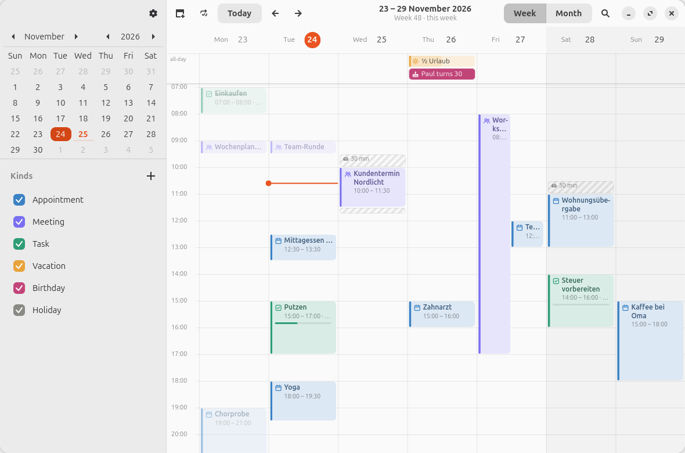
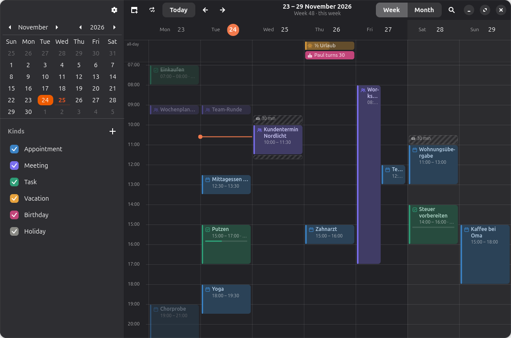
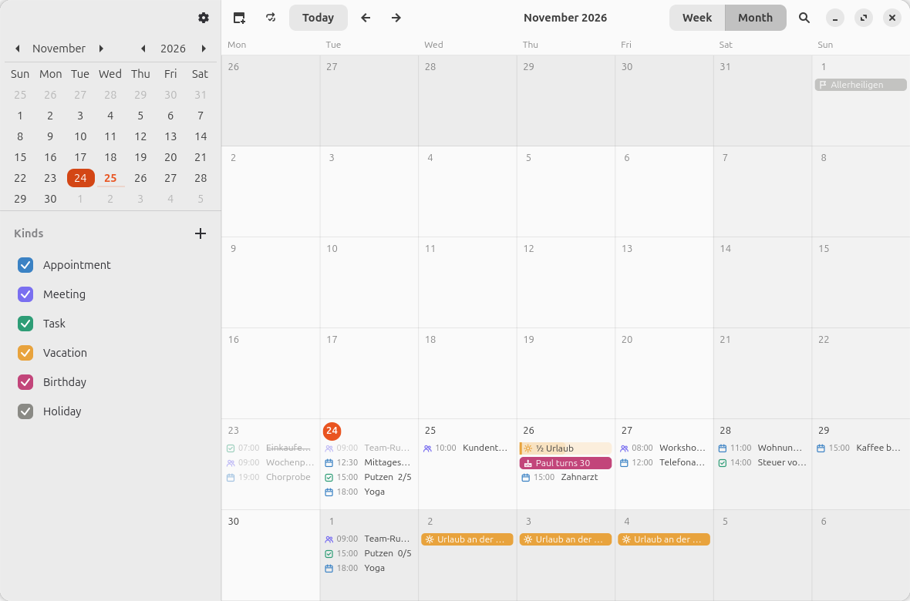

[English](README.md) · **Deutsch**


# Kalender – ein einfacher Kalender für Linux

Ein einfacher, moderner Kalender für Linux (GNOME und KDE), geschrieben in Rust mit GTK 4 und libadwaita. Schwester-App von [E-Mail](https://github.com/digistalter/email).

Gemacht fürs Planen am Computer: Deine Einträge bleiben auf diesem Computer, ohne Konten und ohne Server. Einladungen gehen per E-Mail raus, und Kalender aus dem Netz wie Müllabfuhr oder Schulferien lassen sich abonnieren. Einen Abgleich mit dem Handy gibt es (noch) nicht.



<p>
  
  
</p>

## Funktionen

- **Woche und Monat.** Ein Klick auf einen Tag im kleinen Monatskalender öffnet seine Woche. Gleichzeitige Einträge stehen nebeneinander. Im schmalen Fenster erscheint eine Liste der nächsten Tage.
- **Arten mit Farbe und Symbol:** Termin, Meeting, Aufgabe, Urlaub, Geburtstag, dazu Feiertage für jedes Bundesland. Eigene Arten möglich. Jede Art fragt nur, was zu ihr passt.
- **Aufgaben mit Unteraufgaben** zum Abhaken direkt im Kalender; der Block zeigt den Fortschritt. **Routinen** sind Vorlagen: Ein Klick füllt Titel, Dauer und Unteraufgaben aus.
- **Urlaub** als ganze Tage (erster und letzter Tag) oder halber Tag. Der Kalender zählt die Tage – Wochenenden nur auf Wunsch, Feiertage nie – und zeigt mit hinterlegtem Jahresurlaub, wie viele noch übrig sind.
- **Geburtstage** mit Name und Datum; mit Geburtsjahr zeigt der Kalender das Alter („Paul wird 30“).
- **Serien** (täglich, wöchentlich an gewählten Tagen, alle 2 Wochen, monatlich, jährlich) mit Enddatum oder Anzahl.
- **Reisezeit und Puffer** werden vor und nach einem Eintrag freigehalten; die Erinnerung richtet sich nach dem Losfahren.
- **Ziehen** verschiebt Einträge auf eine andere Zeit oder einen anderen Tag, mit <kbd>Strg</kbd> entsteht eine Kopie. Rechtsklick: Duplizieren, Verschieben nach …, Als Routine speichern, Als Datei speichern, Löschen – immer mit „Rückgängig“.
- **Einladungen per E-Mail.** Der Kalender bereitet die Mail mit einem Standard-Kalenderanhang vor und öffnet sie in deiner Mail-App. Google, Outlook, Apple und Thunderbird verstehen ihn. Antworten werden mit einem Klick übernommen.
- **Abonnierte Kalender.** Link einfügen (webcal, .ics, auch Dropbox- und Nextcloud-Links), der Kalender zeigt ihn zum Lesen an und hält ihn aktuell.
- **Tägliche Datensicherung** aller Daten in einen frei wählbaren Ordner, mit Wiederherstellen.
- **Vergangenes und Erledigtes wird abgeblendet**, damit das Nächste hervortritt.
- Erinnerungen über die Systembenachrichtigungen, auch wenn das Fenster nie geöffnet wurde. Deutsch und Englisch.

## Installieren

Die Installationsdateien liegen bei jeder Version unter [Releases](https://github.com/digistalter/kalender/releases/latest). Passende Datei herunterladen, ein Terminal im Download-Ordner öffnen und den Befehl für dein System ausführen. Danach erscheint „Kalender“ in der App-Übersicht.

### Ubuntu, Debian, Linux Mint, Pop!_OS, elementary OS

Datei: `kalender_1.0.0_amd64.deb` · für Ubuntu 24.04 und neuer, Debian 13 und neuer, Linux Mint 22 und neuer

```bash
sudo apt install ./kalender_1.0.0_amd64.deb
```

### Fedora

Datei: `kalender-1.0.0-1.x86_64.rpm` · für die aktuellen Fedora-Versionen

```bash
sudo dnf install ./kalender-1.0.0-1.x86_64.rpm
```

### Alle anderen Systeme (Flatpak)

Datei: `kalender.flatpak` · läuft auf praktisch jedem Linux, zum Beispiel openSUSE, Arch Linux, Manjaro, EndeavourOS oder ältere Ubuntu- und Debian-Versionen.

Falls Flatpak noch nicht installiert ist, zuerst einmalig:

| System | Befehl |
|---|---|
| openSUSE | `sudo zypper install flatpak` |
| Arch Linux, Manjaro, EndeavourOS | `sudo pacman -S flatpak` |
| Ubuntu, Debian | `sudo apt install flatpak` |

Dann Flathub einrichten (liefert die nötigen GNOME-Bausteine) und die App installieren:

```bash
flatpak remote-add --user --if-not-exists flathub https://dl.flathub.org/repo/flathub.flatpakrepo
```

```bash
flatpak install --user ./kalender.flatpak
```

Starten lässt sich die App dann über die App-Übersicht oder mit `flatpak run io.github.digistalter.Kalender`.

### Wieder entfernen

| Installiert als | Befehl |
|---|---|
| `.deb` | `sudo apt remove kalender` |
| `.rpm` | `sudo dnf remove kalender` |
| Flatpak | `flatpak uninstall --user io.github.digistalter.Kalender` |

Deine Einträge bleiben in `~/.local/share/kalender/` (Flatpak: `~/.var/app/io.github.digistalter.Kalender/`), die täglichen Sicherungen im Ordner Dokumente.

Selbst bauen: siehe [`docs/ENTWICKLUNG.md`](docs/ENTWICKLUNG.md).

## Mitmachen

Fehler und Ideen bitte als [Issue](https://github.com/digistalter/kalender/issues) melden.

## Lizenz

Kalender ist eine offene Community, gesponsert von der [DIGISTALTER GmbH](https://www.digistalter.de).

Dieses Programm ist freie Software: Du kannst es unter den Bedingungen der GNU General Public License, wie von der Free Software Foundation veröffentlicht, weitergeben und/oder verändern, entweder gemäß Version 3 der Lizenz oder (nach deiner Wahl) jeder späteren Version.

Dieses Programm wird in der Hoffnung verbreitet, dass es nützlich ist, aber **ohne jede Gewährleistung**, sogar ohne die implizite Gewährleistung der Marktreife oder der Eignung für einen bestimmten Zweck. Details stehen in der GNU General Public License.

Den vollständigen Lizenztext findest du in der Datei [`LICENSE`](LICENSE).

`SPDX-License-Identifier: GPL-3.0-or-later`
