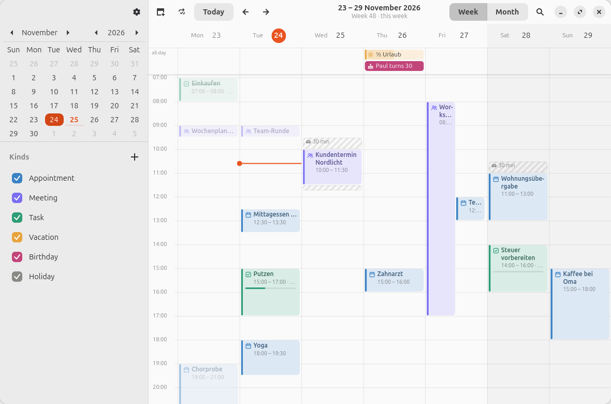
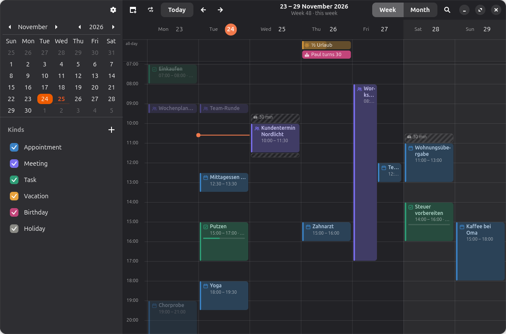
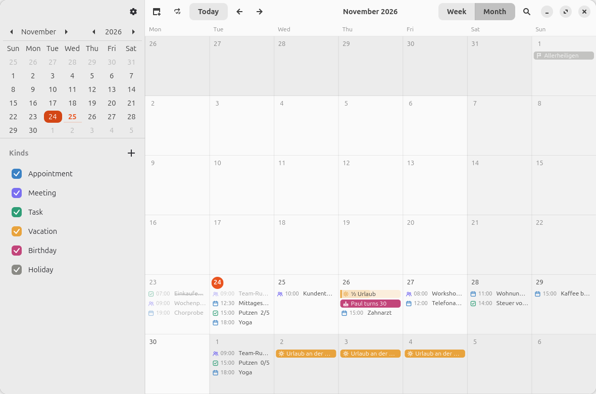

**English** · [Deutsch](README.de.md)


# Kalender – a simple calendar for Linux

A simple, modern calendar for Linux (GNOME and KDE), written in Rust with GTK 4 and libadwaita. Sister app of [E-Mail](https://github.com/digistalter/email).

Made for planning at your computer: your entries stay on this computer, without accounts and without servers. Your computers sync with each other directly in the home network. Invitations go out by e-mail, and you can add calendars from the web, such as waste collection or school holidays. An Android app is in the works.



<p>
  
  
</p>

## Features

- **Week and month.** Clicking a day in the small month calendar opens its week. Entries at the same time stand side by side. Narrow windows show a list of the next days.
- **Kinds with colour and symbol:** appointment, meeting, task, vacation, birthday, plus public holidays for every German federal state. Add your own kinds. Every kind only asks for what fits it.
- **Tasks with subtasks** to tick off right in the calendar; the block shows the progress. **Routines** are templates: one click fills in title, length and subtasks.
- **Vacation** as whole days (first and last day) or a half day. The calendar counts the days – weekends only if you want, holidays never – and, if you enter your yearly allowance, shows how many are left.
- **Birthdays** with name and date; with the year of birth the calendar shows the age (“Paul turns 30”).
- **Series** (daily, weekly on chosen days, every 2 weeks, monthly, yearly) with an end date or number of times.
- **Travel time and buffers** are kept free before and after an entry; the reminder takes the travel time into account.
- **Drag** entries to another time or day; with <kbd>Ctrl</kbd> a copy is made. Right click: duplicate, move to …, save as routine, save as file, delete – always with undo.
- **Invitations by e-mail.** The calendar prepares the mail with a standard calendar attachment and opens it in your mail app. Google, Outlook, Apple and Thunderbird understand it. Answers are taken over with one click.
- **Subscribed calendars.** Paste a link (webcal, .ics, also Dropbox and Nextcloud links) and the calendar shows it read-only and keeps it up to date.
- **Sync in the home network.** Pair your computers once with a code and compare four check words; from then on they sync directly with each other whenever they are in the same Wi-Fi – end-to-end encrypted, without a server or account. All devices are equal; changes made on the way follow at the next meeting.
- **Daily backup** of all data into a folder of your choice, with restore.
- **Past entries and finished tasks fade out**, so the next things stand out.
- Reminders as system notifications, also when the window was never opened. English and German.

## Install

The installation files for every version are under [Releases](https://github.com/digistalter/kalender/releases/latest). Download the file for your system, open a terminal in the download folder and run the command for your system. “Kalender” then shows up in your app overview.

### Ubuntu, Debian, Linux Mint, Pop!_OS, elementary OS

File: `kalender_1.1.0_amd64.deb` · for Ubuntu 24.04 and newer, Debian 13 and newer, Linux Mint 22 and newer

```bash
sudo apt install ./kalender_1.1.0_amd64.deb
```

### Fedora

File: `kalender-1.1.0-1.x86_64.rpm` · for the current Fedora releases

```bash
sudo dnf install ./kalender-1.1.0-1.x86_64.rpm
```

### All other systems (Flatpak)

File: `kalender.flatpak` · runs on practically every Linux, for example openSUSE, Arch Linux, Manjaro, EndeavourOS or older Ubuntu and Debian releases.

If Flatpak is not installed yet, do this once first:

| System | Command |
|---|---|
| openSUSE | `sudo zypper install flatpak` |
| Arch Linux, Manjaro, EndeavourOS | `sudo pacman -S flatpak` |
| Ubuntu, Debian | `sudo apt install flatpak` |

Then add Flathub (it provides the GNOME building blocks) and install the app:

```bash
flatpak remote-add --user --if-not-exists flathub https://dl.flathub.org/repo/flathub.flatpakrepo
```

```bash
flatpak install --user ./kalender.flatpak
```

Start the app from your app overview or with `flatpak run io.github.digistalter.Kalender`.

### Uninstall

| Installed as | Command |
|---|---|
| `.deb` | `sudo apt remove kalender` |
| `.rpm` | `sudo dnf remove kalender` |
| Flatpak | `flatpak uninstall --user io.github.digistalter.Kalender` |

Your entries stay in `~/.local/share/kalender/` (Flatpak: `~/.var/app/io.github.digistalter.Kalender/`), the daily backups in your Documents folder.

Building it yourself: see [`docs/ENTWICKLUNG.md`](docs/ENTWICKLUNG.md) (German).

## Contributing

Please report bugs and ideas as an [issue](https://github.com/digistalter/kalender/issues).

## License

Kalender is an open community sponsored by [DIGISTALTER GmbH](https://www.digistalter.de).

This program is free software: you can redistribute it and/or modify it under the terms of the GNU General Public License as published by the Free Software Foundation, either version 3 of the License, or (at your option) any later version.

This program is distributed in the hope that it will be useful, but **without any warranty**; without even the implied warranty of merchantability or fitness for a particular purpose. See the GNU General Public License for more details.

The full license text is in [`LICENSE`](LICENSE).

`SPDX-License-Identifier: GPL-3.0-or-later`
